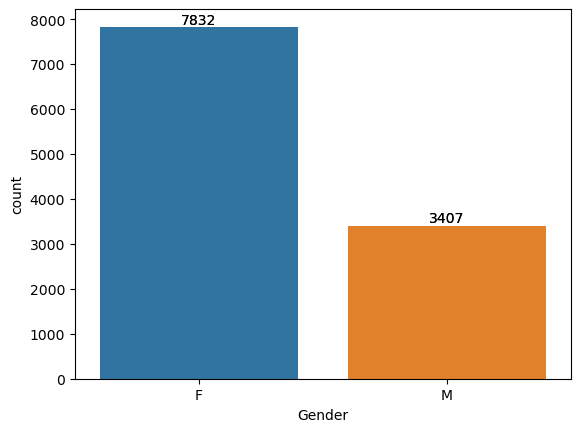
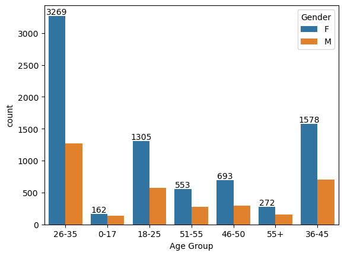

<div align="center">

# 🪔 Diwali Sales Analysis — Customer & Category EDA (Python)

### Festival-season sales intelligence: which customer segments and product categories actually drive Diwali revenue?


-orange)

</div>

---

## 🎯 The Business Problem

Diwali is the highest-stakes sales window in Indian retail. This project analyses festival transaction data to answer the questions a marketing team actually asks before the season:

1. **Which customer segments buy the most?** — gender, age, occupation, city tier, marital status
2. **Which product categories carry the season?** — where to concentrate stock and discounts
3. **Where should campaign budget go?** — segment-level targeting instead of blanket spend

---

## 🗂️ Repository Structure

```text
Diwali_Sales_Analysis-Python/
│
├── README.md
├── requirements.txt
├── .gitignore
│
├── data/
│   └── Diwali Sales Data.csv         # raw Kaggle dataset
│
├── notebooks/
│   └── diwali_sales_analysis.ipynb   # full EDA walkthrough
│
├── reports/
│   └── Diwali Sales Analysis.pptx    # stakeholder presentation
│
└── assets/                           # charts embedded in this README
```

---

## 🧹 The Data Pipeline (Notebook Walkthrough)

1. **Load** the raw Diwali sales dataset.
2. **Clean** — drop unused identifier columns, handle nulls in the secondary/tertiary category columns, enforce correct dtypes.
3. **Explore** — purchase totals and distributions across `Gender`, `Age`, `Occupation`, `City_Category`, `Marital_Status`, `Stay_In_Current_City_Years` and product categories.
4. **Translate** findings into segment-level targeting recommendations.

---

## 📊 Key Insights

*(Verify figures against your notebook output before publishing.)*

- **One gender contributes a clearly larger share of total purchase value** — campaign creative and channel mix should reflect this skew.
- **The 26–35 age group is the revenue engine** of the festival season, followed by 36–45.
- **Product Category 1 dominates purchases**, with Categories 2–3 acting as add-ons — bundle them, don't discount them separately.
- **City-tier split shows where growth headroom sits**: the top-contributing city category confirms core market strength, while lower tiers indicate expansion potential.
- **Occupation-based cuts reveal 2–3 segments punching above their size** — ideal lookalike audiences for paid campaigns.





---

## 📖 Data Dictionary

| Column | Description |
|---|---|
| `User_ID` | Unique customer identifier |
| `Product_ID` | Unique product identifier |
| `Gender` | Customer gender |
| `Age` | Binned age group (e.g., 26-35) |
| `Occupation` | Occupation code |
| `City_Category` | City tier (A / B / C) |
| `Stay_In_Current_City_Years` | Years resident in current city |
| `Marital_Status` | 1 = married, 0 = unmarried |
| `Product_Category_1/2/3` | Primary / secondary / tertiary category (2 & 3 nullable) |
| `Purchase` | Purchase value in currency units |

---

## 🛠️ Tech Stack

Python · Pandas · NumPy · Matplotlib · Seaborn · Jupyter

---

## 💻 How to Run

```bash
git clone https://github.com/JatinD18/Diwali_Sales_Analysis-Python.git
cd Diwali_Sales_Analysis-Python
pip install -r requirements.txt
jupyter notebook notebooks/diwali_sales_analysis.ipynb
```

---

## ⚠️ Limitations

- Transaction-level snapshot of one festival season; no repeat-purchase or customer-lifetime view.
- Occupation and city tier are coded, not labelled — interpretations follow standard dataset conventions.
- No pricing or margin data, so analysis is revenue-side only.

---

## 👤 Author

**Jatin Naresh Dolas** — Data Analyst | SQL · Python · Power BI · Streamlit

[](https://github.com/JatinD18)
[](https://www.linkedin.com/in/jatin-dolas)
